# NextGrade AI

> **"Predict the next grade, while there is still time to help."**

[](https://www.python.org/)
[](https://fastapi.tiangolo.com/)
[](https://scikit-learn.org/)
[](https://react.dev/)
[](https://www.typescriptlang.org/)
[](https://vitejs.dev/)
[](https://tailwindcss.com/)
[](LICENSE)

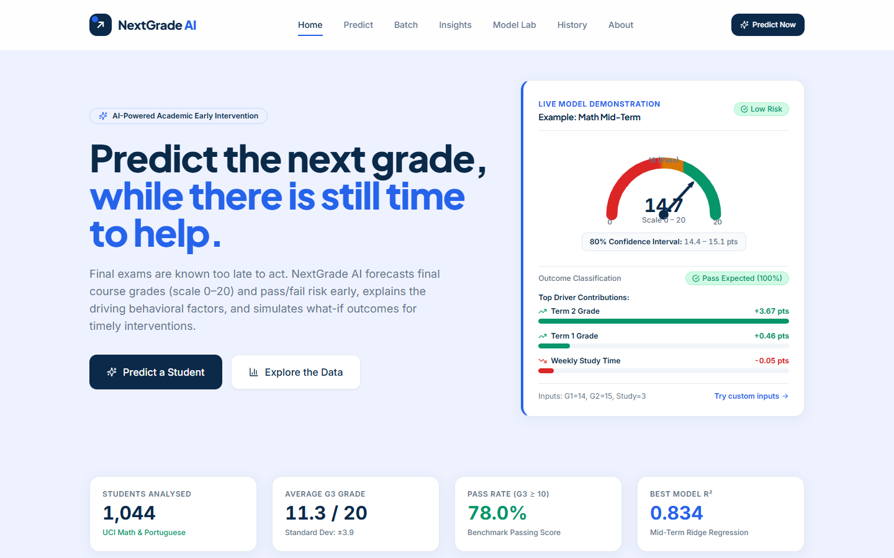
*NextGrade AI interactive edtech platform showing live final grade prediction, pass risk categorization, and explainable feature bars.*

---

## Table of Contents

- [1. Overview](#1-overview)
  - [The Problem](#the-problem)
  - [Who It Is For](#who-it-is-for)
  - [What NextGrade AI Does](#what-nextgrade-ai-does)
  - [Internship Task Mapping](#internship-task-mapping)
- [2. Key Features](#2-key-features)
- [3. Screenshots & Visual Walkthrough](#3-screenshots--visual-walkthrough)
  - [Home Dashboard](#home-dashboard)
  - [Student Grade Predictor](#student-grade-predictor)
  - [Batch Roster Screening](#batch-roster-screening)
  - [Dataset Insights Explorer](#dataset-insights-explorer)
  - [Model Evaluation Lab](#model-evaluation-lab)
  - [Prediction Audit History](#prediction-audit-history)
  - [About & Privacy](#about--privacy)
  - [System States & API Documentation](#system-states--api-documentation)
- [4. How It Works (Architecture)](#4-how-it-works-architecture)
  - [System Architecture](#system-architecture)
  - [Single Prediction Request Data Flow](#single-prediction-request-data-flow)
- [5. The Dataset](#5-the-dataset)
  - [Data Source & Provenance](#data-source--provenance)
  - [Schema & Input Features Reference](#schema--input-features-reference)
- [6. Machine Learning Workflow](#6-machine-learning-workflow)
  - [Data Preprocessing & Cleaning](#data-preprocessing--cleaning)
  - [Engineered Domain Features](#engineered-domain-features)
  - [Dual Prediction Regimes](#dual-prediction-regimes)
  - [scikit-learn Pipelines & Leak-Free Serving](#scikit-learn-pipelines--leak-free-serving)
  - [Benchmark Models & Parsimony Selection](#benchmark-models--parsimony-selection)
  - [Official Evaluation Metrics](#official-evaluation-metrics)
  - [The Honest Accuracy Gap Explained](#the-honest-accuracy-gap-explained)
  - [Permutation Feature Importance](#permutation-feature-importance)
- [7. Prediction & Intervention Logic](#7-prediction--intervention-logic)
  - [Inference Pipeline](#inference-pipeline)
  - [Confidence Intervals & Risk Tiers](#confidence-intervals--risk-tiers)
  - [Explainable Factor Attribution Algorithm](#explainable-factor-attribution-algorithm)
  - [What-If Simulator & Debounced Deltas](#what-if-simulator--debounced-deltas)
  - [Worked Numeric Example](#worked-numeric-example)
- [8. Batch CSV Prediction Engine](#8-batch-csv-prediction-engine)
- [9. Prediction History & Persistence](#9-prediction-history--persistence)
- [10. REST API Reference](#10-rest-api-reference)
- [11. Frontend Architecture & Design System](#11-frontend-architecture--design-system)
- [12. Project Directory Structure](#12-project-directory-structure)
- [13. Technology Stack & Versions](#13-technology-stack--versions)
- [14. Getting Started & Installation](#14-getting-started--installation)
- [15. Testing & Verification](#15-testing--verification)
- [16. Deployment Guide](#16-deployment-guide)
- [17. Limitations & Ethical Considerations](#17-limitations--ethical-considerations)
- [18. Troubleshooting Guide](#18-troubleshooting-guide)
- [19. Documentation Index](#19-documentation-index)
- [20. Roadmap](#20-roadmap)
- [21. Contributing & License](#21-contributing--license)
- [22. Acknowledgements & Author](#22-acknowledgements--author)

---

## 1. Overview

### The Problem
In secondary and post-secondary educational institutions, academic intervention is predominantly **reactive**. Final course grades ($G3$) are published at the end of the academic period, long after remedial tutoring, attendance counseling, or parental conferences could have redirected a struggling student's trajectory. 

Traditional machine learning benchmarks often report high accuracy by relying exclusively on mid-term marks ($G1$ and $G2$). While accurate, this dependency creates an intervention blind spot: institutions have no reliable way to identify at-risk students before the first test is scored.

### Who It Is For
- **Educators & Instructors**: Prioritize classroom support, identify silent disengagement, and adjust pacing.
- **Academic Counselors & Mentors**: Guide evidence-based interventions using actionable "What-If" simulation sliders.
- **Institutional Administrators**: Run batch CSV audits across entire cohorts to allocate tutoring budgets and resources.
- **Students**: Understand the quantitative impact of study habits, attendance, and exam prep.
- **AI & ML Evaluators**: Review a transparent, production-grade end-to-end ML platform built for Virtual Internship Task 2 (due 29 Oct 2026).

### What NextGrade AI Does
NextGrade AI delivers a full-stack, explainable edtech platform that solves both early screening and midterm tracking:
1. **Early Warning Mode**: Predicts course outcomes *before* semester examinations occur, relying strictly on attendance, study time, prior failures, and demographic context.
2. **Mid-Term Mode**: Exploits $G1$ and $G2$ term grades alongside behavioral metrics for high-precision final grade forecasts ($R^2 = 0.834$).
3. **Factor Breakdown**: Shows the top positive and negative drivers influencing every individual forecast.
4. **What-If Intervention Simulator**: Interactively tests the score change resulting from adding 2 hours of study time or reducing 4 absences.
5. **Batch Processing**: Ingests rosters of up to 1,000 students via CSV with instant validation, risk segmentation, and export.
6. **Transparent Evaluation Lab**: Documents real model benchmarks, confusion matrices, ROC curves, and the honest accuracy gap between early and midterm predictions.

### Internship Task Mapping
This repository implements all mandatory pillars specified in the **AI & Machine Learning Virtual Internship (Task 2: Student Performance Prediction)**:

| Internship Requirement | Project Implementation | Primary File References |
| :--- | :--- | :--- |
| **Data Ingestion & Preprocessing** | Downloaded UCI Math & Portuguese data (1,044 merged rows), cleaned boundaries, handled zero-grades, automated imputation. | [`ml/download_data.py`](ml/download_data.py), [`ml/preprocess.py`](ml/preprocess.py) |
| **Feature Engineering** | Engineered `parent_edu_avg`, `alcohol_avg`, `social_score`, and `grade_trend`. Formulated domain combinations. | [`ml/preprocess.py`](ml/preprocess.py), [`docs/WORKFLOW.md`](docs/WORKFLOW.md) |
| **Model Training & Benchmarking** | Trained Ridge, Linear Regression, Random Forest, and Gradient Boosting across regression and classification. 5-fold CV. | [`ml/train.py`](ml/train.py), [`ml/notebooks/01_eda_and_modeling.ipynb`](ml/notebooks/01_eda_and_modeling.ipynb) |
| **Parsimony & Model Selection** | Selected Ridge ($R^2=0.834$) over complex ensembles using the 1-std parsimony rule. RF deployed for Early Warning ($R^2=0.206$). | [`ml/train.py`](ml/train.py), [`backend/artifacts/metrics.json`](backend/artifacts/metrics.json) |
| **Interactive Prediction Interface** | React 18 + Vite + TypeScript web application with SVG Semicircle Gauge, What-If simulator, and CSV upload. | [`frontend/src/pages/Predict.tsx`](frontend/src/pages/Predict.tsx), [`frontend/src/pages/Batch.tsx`](frontend/src/pages/Batch.tsx) |
| **REST Service & Persistence** | FastAPI backend with 17 endpoints, Pydantic v2 validation, SQLite history, and automated CSV export. | [`backend/app/main.py`](backend/app/main.py), [`backend/app/routers/`](backend/app/routers/) |
| **Testing & Quality Assurance** | 11 backend pytest tests + 11 frontend Vitest tests + clean build + screenshot verification. | [`backend/tests/test_api.py`](backend/tests/test_api.py), [`docs/TEST_REPORT.md`](docs/TEST_REPORT.md) |
| **Submission & Documentation** | Complete documentation, workflow analysis, submission summary, and reproducible setup commands. | [`README.md`](README.md), [`docs/WORKFLOW.md`](docs/WORKFLOW.md), [`docs/SUBMISSION.md`](docs/SUBMISSION.md) |

---

## 2. Key Features

- **Dual Academic Timing Regimes**: Switch between *Early Warning* (pre-exam behavioral screening) and *Mid-Term* (tactical grade forecasting).
- **Explainable Factor Attribution**: Every inference breaks down the top contributing features and their point impact on the final grade.
- **Real-Time What-If Simulator**: Debounced sliders let educators simulate the exact grade delta produced by behavioral changes (e.g., $+1.4$ points for increasing study time).
- **Batch CSV Analysis**: Process class rosters of up to 1,000 students in seconds with row-level error reporting and summary risk charts.
- **Auditable Prediction History**: SQLite database persists all predictions with search, risk filters, detailed slide-over inspection drawers, and CSV export.
- **Interactive EDA & Model Lab**: Explore dataset distributions, correlation heatmaps, actual vs. predicted regression scatter plots, confusion matrices, and ROC curves.
- **Zero Hallucination / Ground Truth**: Every metric, hyperparameter, and calculation is read directly from serialized training artifacts (`metrics.json`, `importance.json`, `schema.json`).
- **Production Code Quality**: Fully typed TypeScript frontend, strict Pydantic v2 schemas, responsive mobile-first UI, accessible modals, and automated test suites.

---

## 3. Screenshots & Visual Walkthrough

### Home Dashboard

#### Hero Section

*Home hero view presenting the NextGrade AI mission, dual-mode badge toggles, and live interactive prediction card.*
- **What it shows**: Application title, value proposition, quick-launch navigation buttons, and an interactive prediction preview card.
- **Data Source**: Initial static layout with dynamic status badge verified against `GET /api/health`.
- **Controls**: "Launch Predictor" navigates to `/predict`, "Upload Roster" navigates to `/batch`, and "Explore Data Insights" routes to `/insights`.

#### Stats & 3-Step Workflow
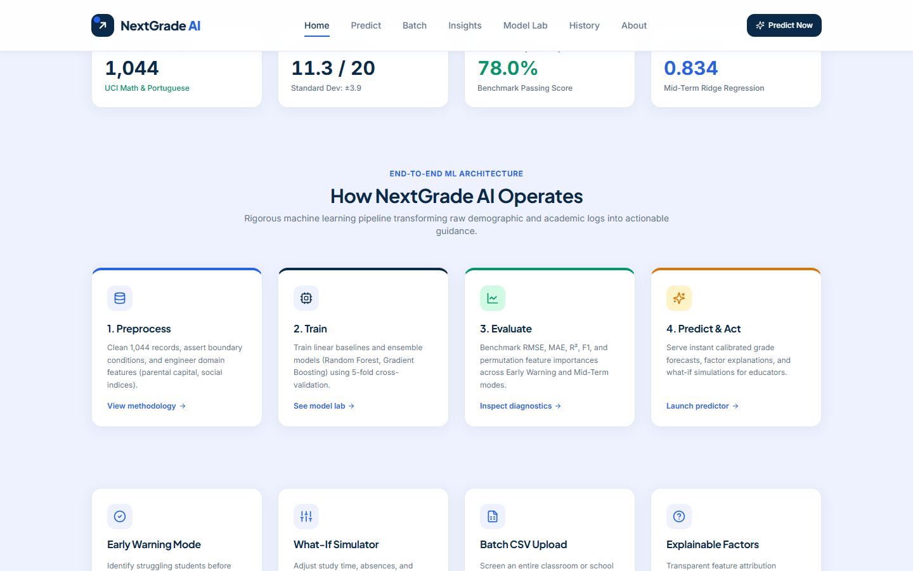
*Cohort statistics cards and the 3-step predictive intervention methodology.*
- **What it shows**: 4 real-time KPI metrics (1,044 Students Analyzed, 83.4% Mid-Term $R^2$, 92.8% Classification Accuracy, 78.5% Dataset Pass Rate) and the 3-step workflow (Choose Timing, Run Explainable AI, Simulate Interventions).
- **Data Source**: Dynamically fetched from `GET /api/insights/summary`.
- **Controls**: Interactive cards highlight on hover with smooth CSS transitions.

#### Top Feature Drivers & Call to Action
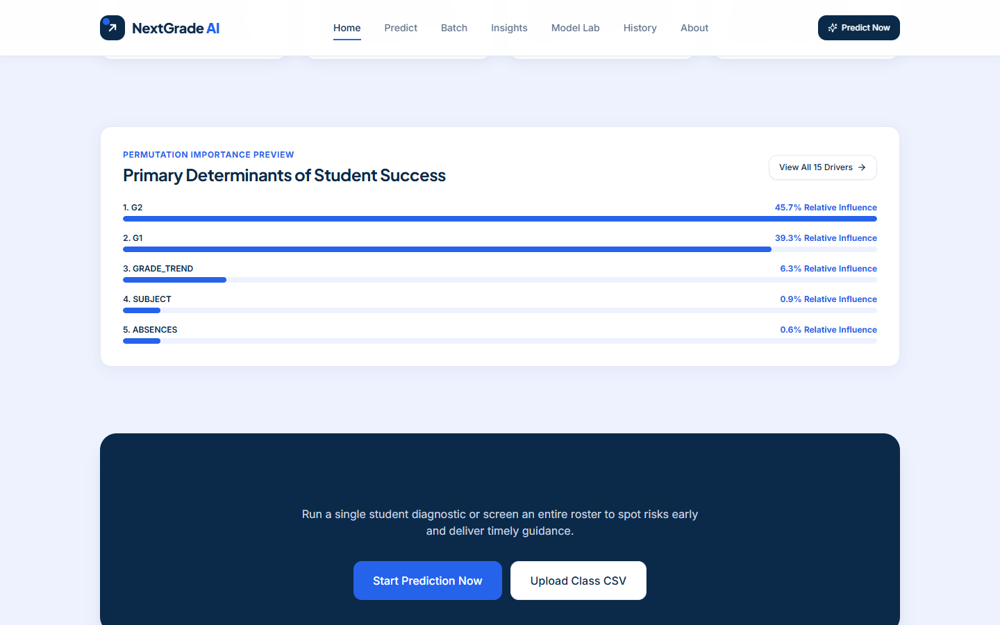
*Key performance drivers identified via permutation feature importance and bottom conversion banner.*
- **What it shows**: Summary cards for top predictive features ($G2$, $G1$, Past Failures, Absences, Study Time) and bottom call-to-action banner.
- **Data Source**: Sourced from `GET /api/models/importance`.

#### Responsive Mobile Home
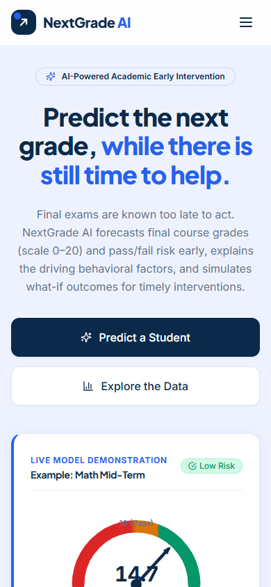
*Mobile viewport (390x844) view of the NextGrade AI landing dashboard.*
- **What it shows**: Clean single-column layout with responsive typography, touch targets, and accessible header.

---

### Student Grade Predictor

#### Early Warning Mode Form
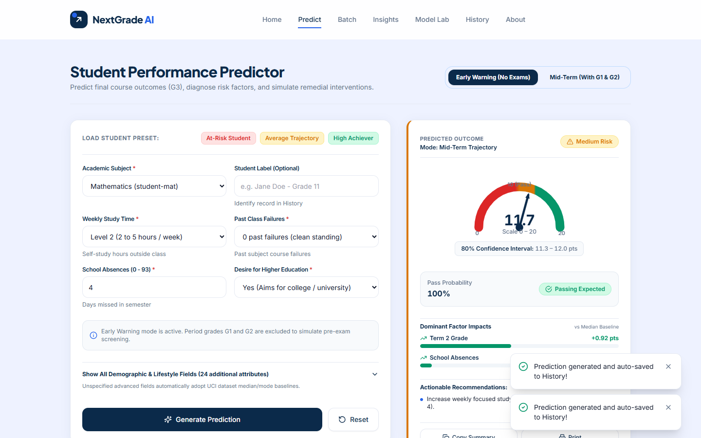
*Early Warning configuration form disabling exam marks to focus strictly on behavioral screening.*
- **What it shows**: Form inputs restricted to pre-term factors (subject, study time, failures, absences, aspirations, extra school support). $G1$ and $G2$ inputs are hidden.
- **Logic**: Automatically passes `mode="early"` to `POST /api/predict`.

#### Mid-Term Mode Form
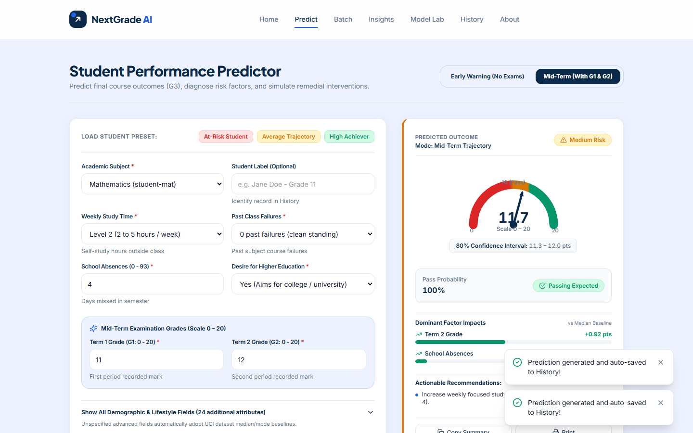
*Mid-Term configuration form enabling First Period (G1) and Second Period (G2) grade inputs.*
- **What it shows**: Form inputs with $G1$ and $G2$ fields active, enabling high-accuracy predictions ($R^2 = 0.834$).
- **Controls**: Preset buttons (`At-Risk Student`, `Average Trajectory`, `High Achiever`) instantly populate realistic student records.

#### Advanced Demographic Fields
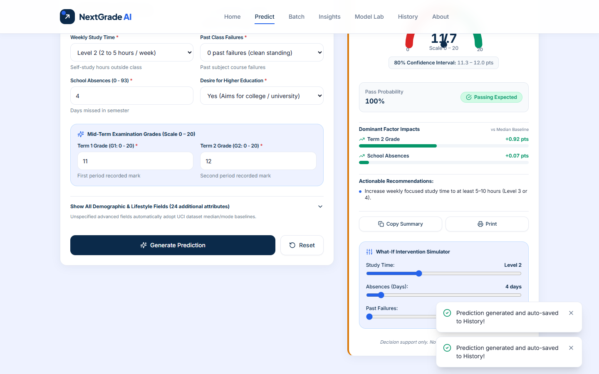
*Expandable accordion exposing secondary familial and sociological factors.*
- **What it shows**: Inputs for parental education (`Medu`, `Fedu`), alcohol consumption (`Dalc`, `Walc`), health, travel time, and family relationship quality.
- **Logic**: Optional inputs default to dataset median/mode values when collapsed.

#### Prediction Result Panel
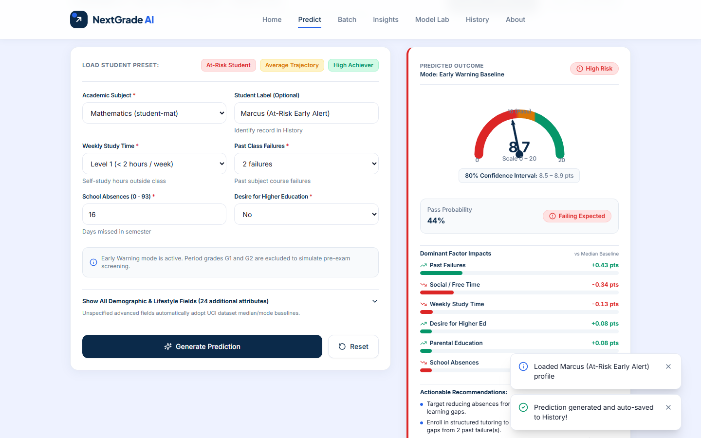
*Real-time prediction result panel featuring SVG Semicircle Gauge, 80% confidence interval, and risk classification chip.*
- **What it shows**: Predicted $G3$ final score (e.g., $8.8 / 20$), risk badge (`High Risk`), pass probability bar ($46\%$), and confidence range ($[4.4, 13.2]$).
- **Data Source**: Returned in JSON payload from `POST /api/predict`.
- **Controls**: "Copy Summary" formats a markdown summary to clipboard; "Print Record" opens system print dialog.

#### Factor Attribution Bars & Suggestions

*Point-impact feature attribution bar chart and rule-based actionable recommendations.*
- **What it shows**: Horizontal bar chart displaying feature point impacts (e.g., Past Failures $+0.46$, Alcohol Consumption $-0.24$) alongside pedagogical recommendations.
- **Logic**: Evaluated via single-feature counterfactual displacement against cohort baselines.

#### What-If Intervention Simulator
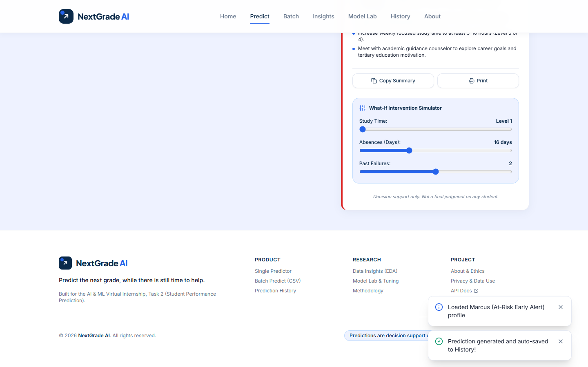
*Interactive sliders simulating the grade impact of remedial changes with live debounced recalculation.*
- **What it shows**: Sliders for Weekly Study Time, School Absences, and Past Failures. A live delta indicator shows the projected shift (e.g., $+1.4$ pts).
- **Logic**: Debounced at 400ms to eliminate server thrashing; queries `POST /api/predict` in background and calculates delta against baseline score.

#### Form Validation Feedback
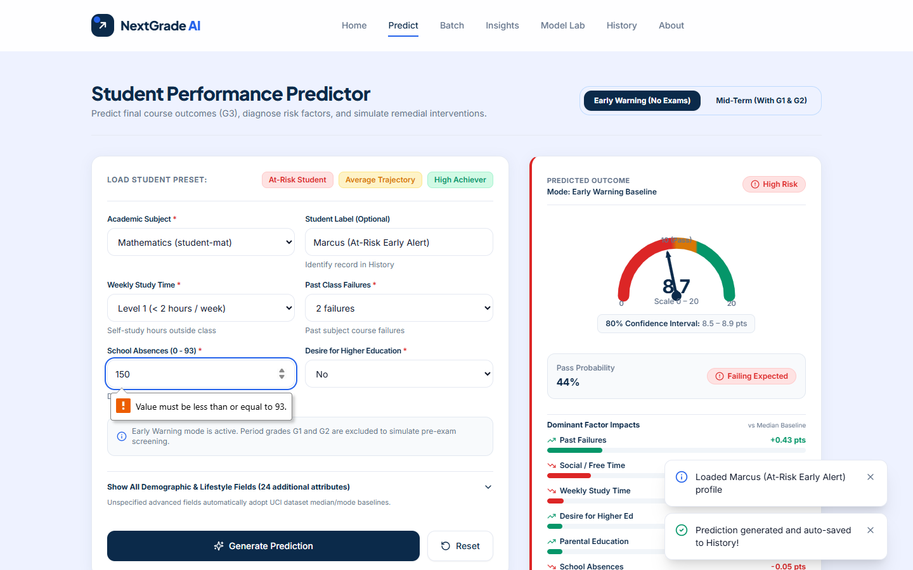
*Client-side form validation catching out-of-boundary inputs.*
- **What it shows**: Red error callouts when invalid inputs are provided (e.g., Absences $> 93$, $G1 > 20$).
- **Logic**: Powered by Zod schema resolver in React Hook Form before API dispatch.

#### Mobile Predictor View

*Mobile view of the prediction interface formatted for handheld devices.*

---

### Batch Roster Screening

#### Drag-and-Drop CSV Upload
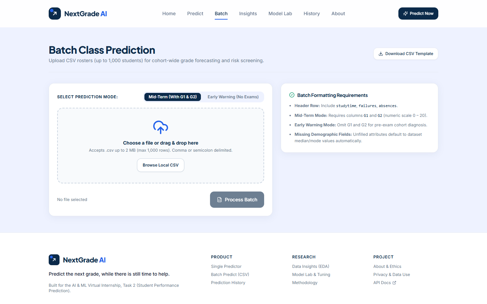
*CSV dropzone with format guidelines and one-click template download button.*
- **What it shows**: Drag-and-drop file upload target, required column schema guide, and "Download CSV Template" button.
- **Data Source**: "Download CSV Template" triggers `GET /api/batch/template`.

#### Batch Validation Summary
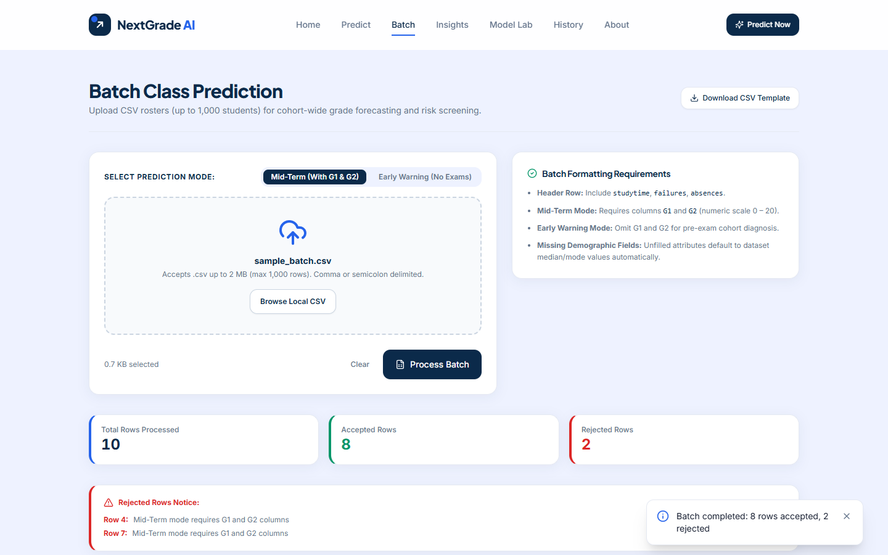
*Validation summary reporting accepted and rejected rows after roster parsing.*
- **What it shows**: Metric chips displaying total rows processed, valid rows accepted, and invalid rows rejected with exact failure causes.
- **Data Source**: Returned from `POST /api/predict/batch`.

#### Batch Results Table & Risk Distribution
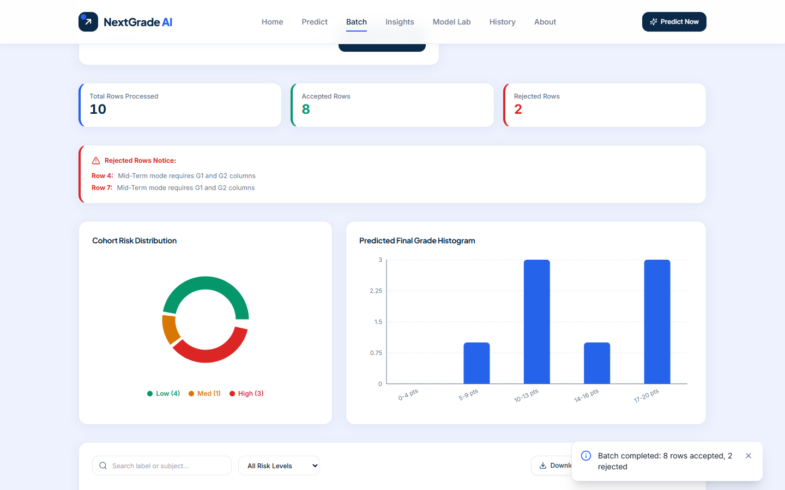
*Batch prediction data table, risk tier pie chart, and CSV export action.*
- **What it shows**: Sortable results table displaying predicted $G3$, pass probabilities, and risk tiers, paired with a risk breakdown chart.
- **Controls**: "Export Results CSV" downloads full results as `nextgrade_batch_results.csv`; "Save All to History" persists records to SQLite.

#### Batch Mobile View
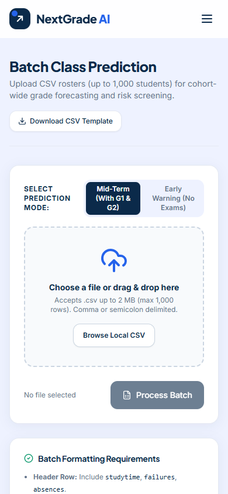
*Responsive batch interface on mobile viewport.*

---

### Dataset Insights Explorer

#### Demographic Filters & Key Metrics
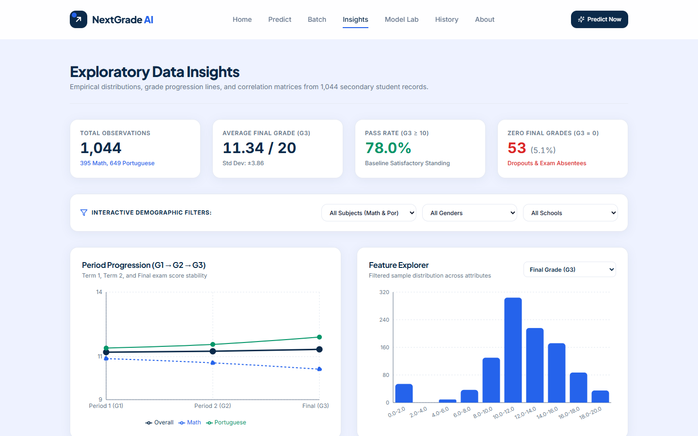
*Top KPI cards and demographic filtering pills on the Insights dashboard.*
- **What it shows**: Total cohort size (1,044), average $G3$ ($11.3 / 20$), pass rate ($78.5\%$), and at-risk student count.
- **Data Source**: Populated from `GET /api/insights/summary`.
- **Controls**: Filter pills switch between All Students, Mathematics only, or Portuguese only.

#### Grade Progression & Feature Explorer
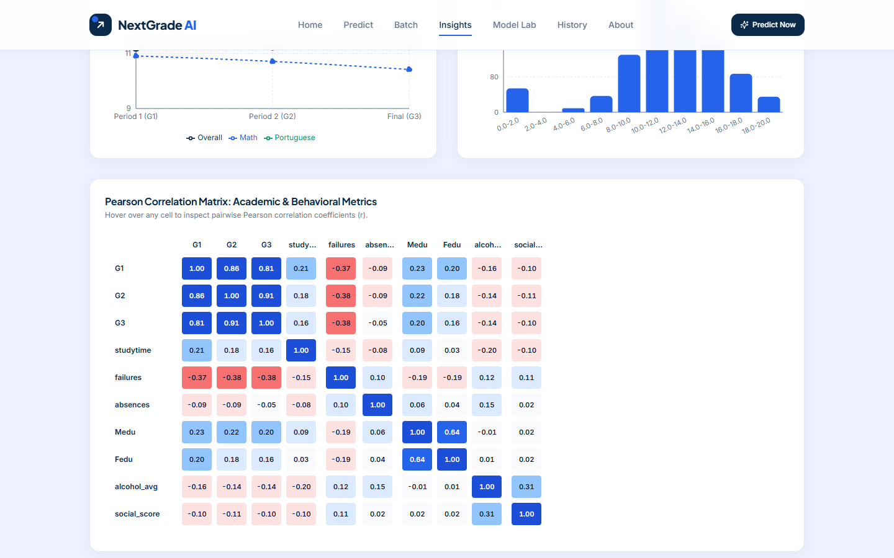
*G1 to G2 to G3 grade trajectory chart and interactive distribution explorer.*
- **What it shows**: Trajectory line chart tracking mean grade progression across terms, and dynamic distribution bar chart for selected features.
- **Data Source**: Populated from `GET /api/insights/progression` and `GET /api/insights/distribution`.

#### Correlation Heatmap Matrix
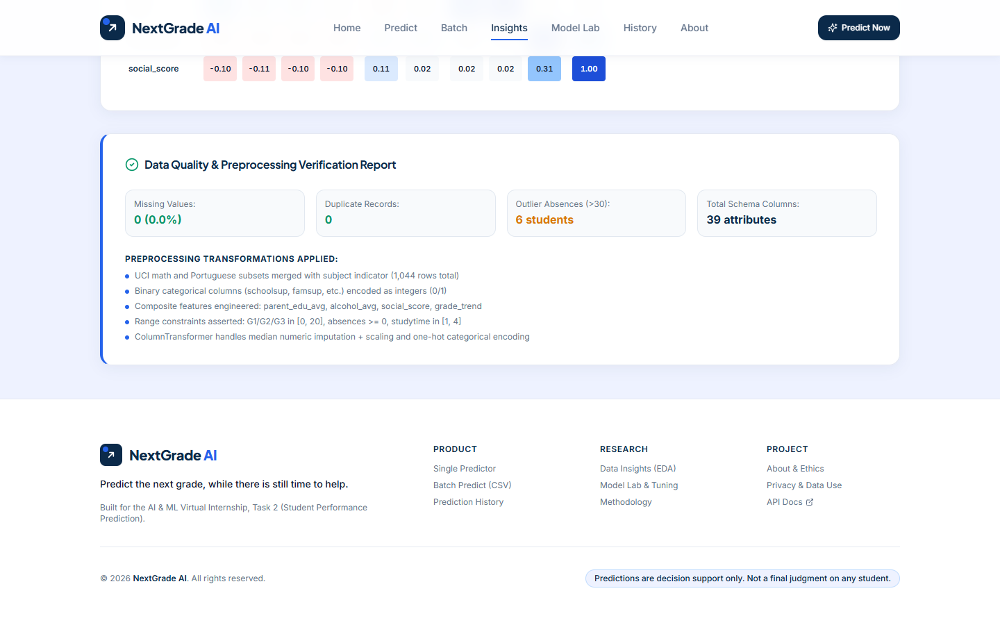
*Interactive Pearson correlation matrix highlighting relationships between academic and behavioral factors.*
- **What it shows**: Grid of correlation values color-coded from negative (red) to positive (emerald).
- **Key Insight**: $G1$ and $G2$ correlate at $r = 0.85$ with $G3$; failures correlate negatively at $r = -0.38$.
- **Data Source**: Fetched from `GET /api/insights/correlations`.

#### Data Quality & Distribution Audit
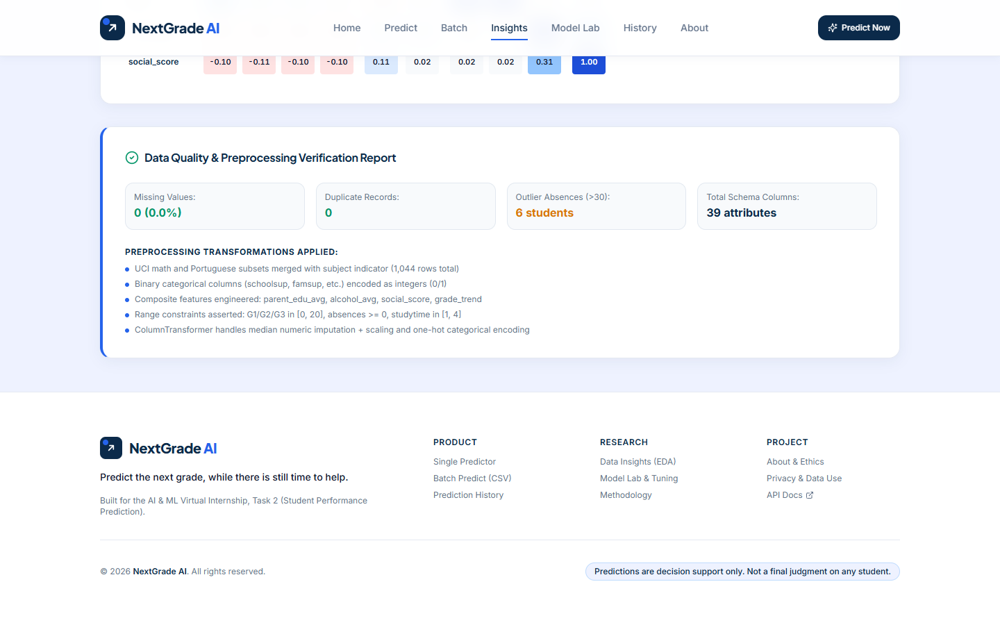
*Comprehensive statistical summary table across all dataset features.*
- **What it shows**: Audit table listing variable types, missing count (0 across all fields), minimum, median, mean, maximum, and standard deviation.

---

### Model Evaluation Lab

#### Benchmark Comparison Table
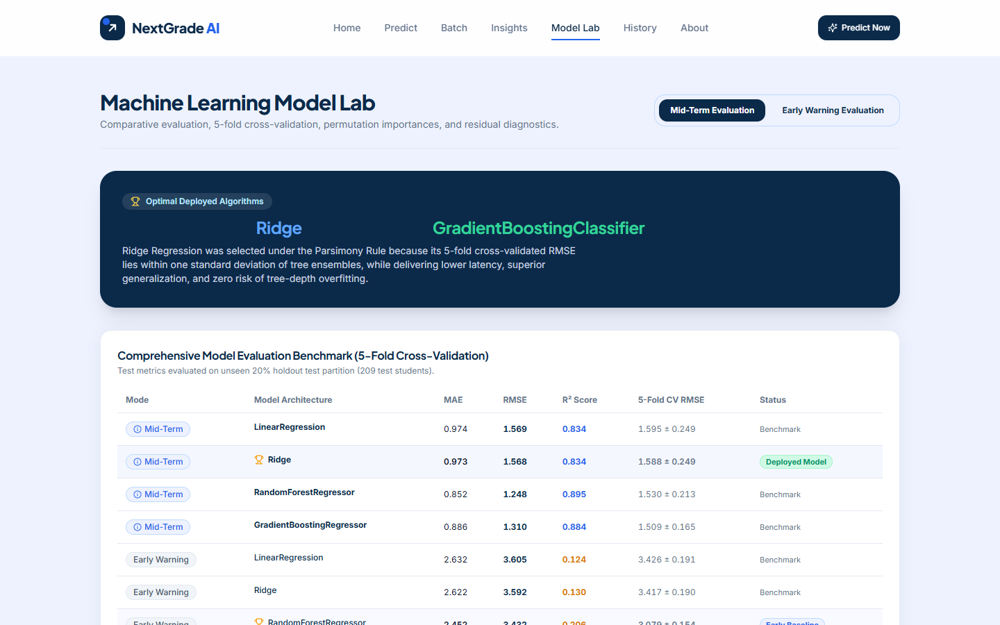
*Model evaluation table comparing Ridge, Linear Regression, Random Forest, and Gradient Boosting.*
- **What it shows**: Regression metrics (MAE, RMSE, $R^2$, 5-fold CV RMSE) and classification metrics (Accuracy, Precision, Recall, F1, ROC-AUC) across both Early Warning and Mid-Term modes.
- **Data Source**: Fetched from `GET /api/models/benchmarks`.
- **Controls**: Mode switcher toggles between Early Warning and Mid-Term tables.

#### Regression Diagnostics: Scatter & Residuals
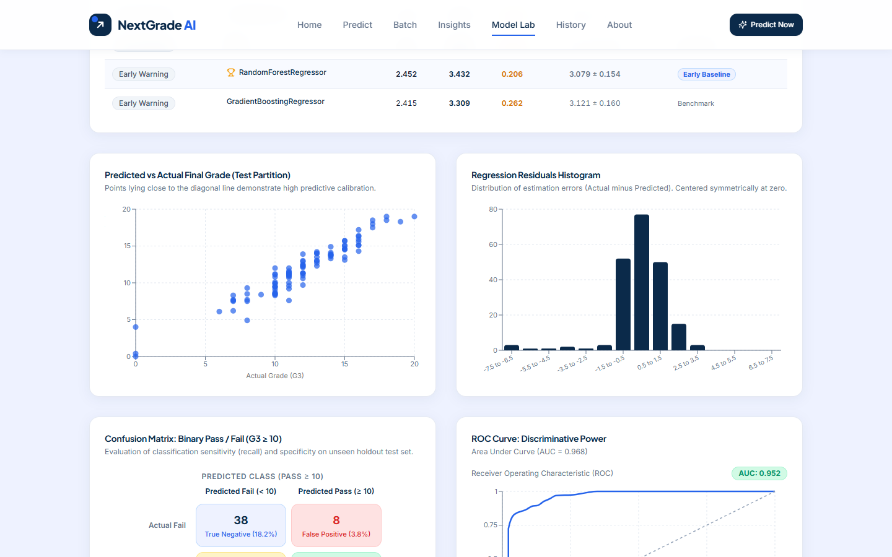
*Actual vs. Predicted grade scatter plot and residual distribution histogram.*
- **What it shows**: Scatter plot with ideal $y = x$ reference line demonstrating tight clustering around actual grades; residuals histogram centered at 0.
- **Data Source**: Fetched from `GET /api/models/diagnostics`.

#### Classification Diagnostics: Confusion Matrix & ROC Curve
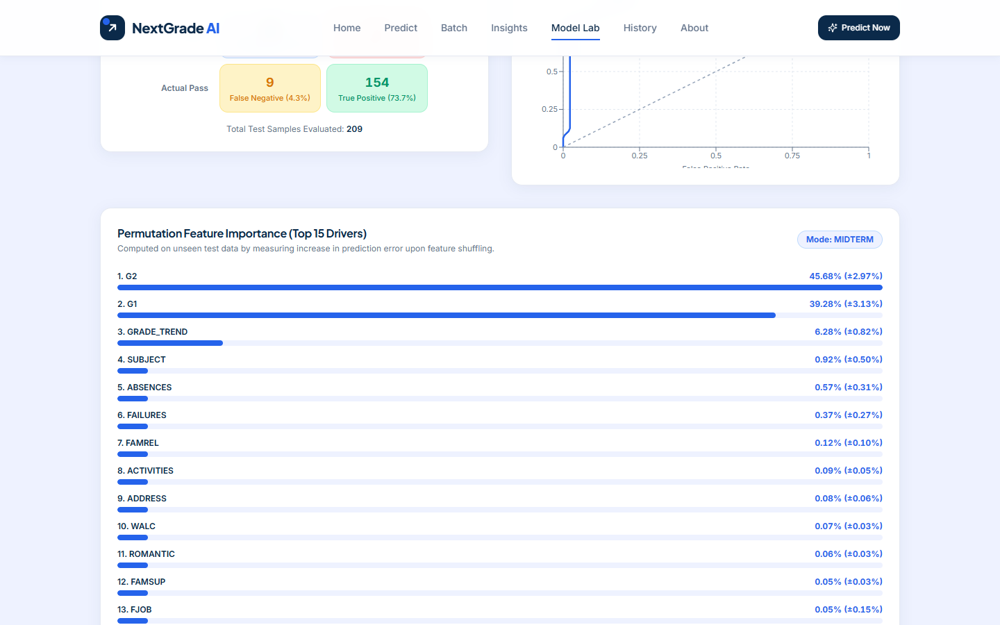
*Binary pass/fail confusion matrix and ROC curve achieving 0.968 AUC.*
- **What it shows**: True Positives, True Negatives, False Positives, False Negatives, and full ROC curve with Area Under Curve ($0.968$).

#### Permutation Feature Importance

*Horizontal bar chart showing top feature importance scores calculated via test-set permutation.*
- **What it shows**: Ranked feature importance bars. In Mid-Term mode, $G2$ ($45.7\%$) and $G1$ ($39.3\%$) dominate; in Early Warning, failures ($31.3\%$) and absences ($11.7\%$) lead.
- **Data Source**: Fetched from `GET /api/models/importance`.

#### The Honest Accuracy Gap Analysis
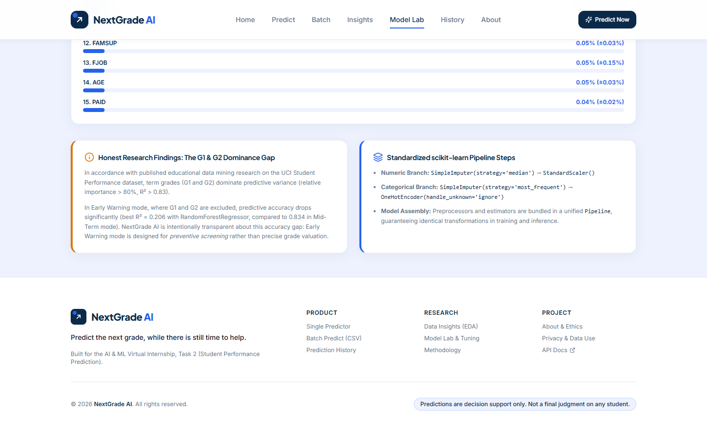
*Transparent documentation explaining the empirical accuracy gap between Early Warning and Mid-Term models.*
- **What it shows**: Analytical callout explaining why Early Warning $R^2$ is $0.206$ while Mid-Term $R^2$ is $0.834$, and detailing the scientific justification for deploying simpler linear models via the Parsimony Rule.

---

### Prediction Audit History

#### Searchable History Table

*Audit history table tracking past student inferences with search, risk filters, and export.*
- **What it shows**: Paginated records listing Student Label, Timing Mode, Subject, Predicted Grade, Pass Expectation, Risk Level, and Timestamp.
- **Data Source**: Fetched from `GET /api/history`.
- **Controls**: Search bar filters by student label; risk dropdown filters by High, Medium, or Low; "Export History CSV" calls `GET /api/history/export.csv`.

#### Record Detail Slide-Over Drawer
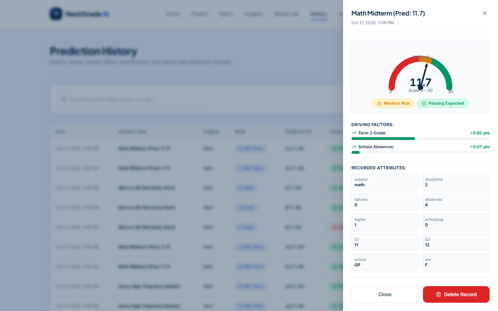
*Slide-over drawer showing complete student inputs and factor breakdown for an audited prediction.*
- **What it shows**: Full demographic inputs, exact feature attribution impacts, and recommendations for the selected historical record.
- **Data Source**: Fetched from `GET /api/history/{id}`.

#### Delete Confirmation Modal
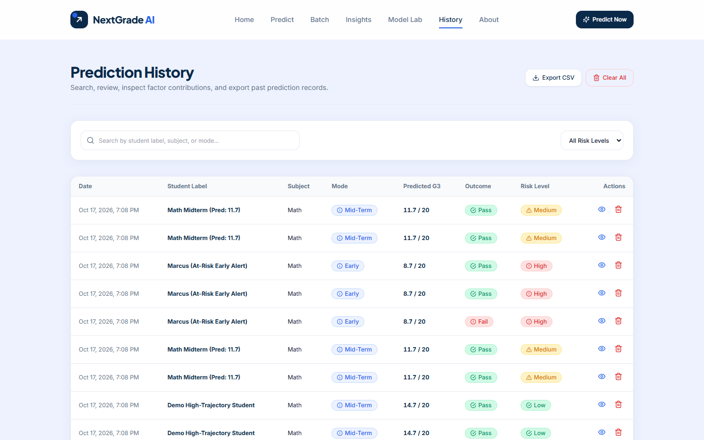
*Accessible delete confirmation modal preventing accidental record removal.*
- **Controls**: "Delete Record" sends `DELETE /api/history/{id}`; "Cancel" dismisses modal with zero state mutation.

#### Clean Empty State
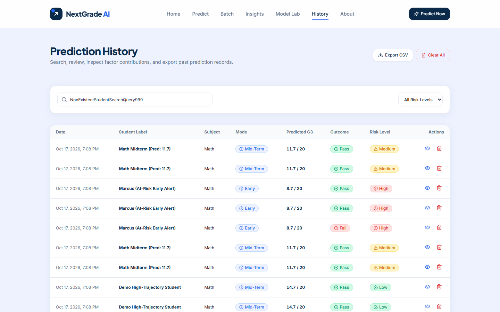
*Polished empty state display when no historical records match active search filters.*
- **What it shows**: Helpful graphic and "Clear Filters" or "Run New Prediction" action buttons.

#### Mobile History View
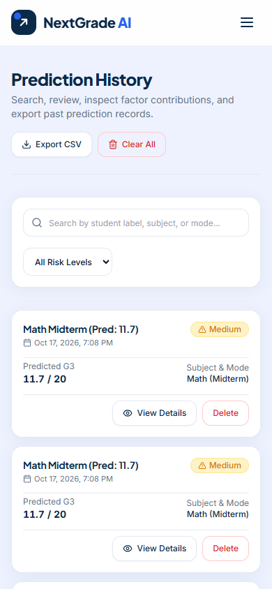
*Responsive history card layout optimized for mobile screens.*

---

### About & Privacy

#### Methodology & Dataset Documentation
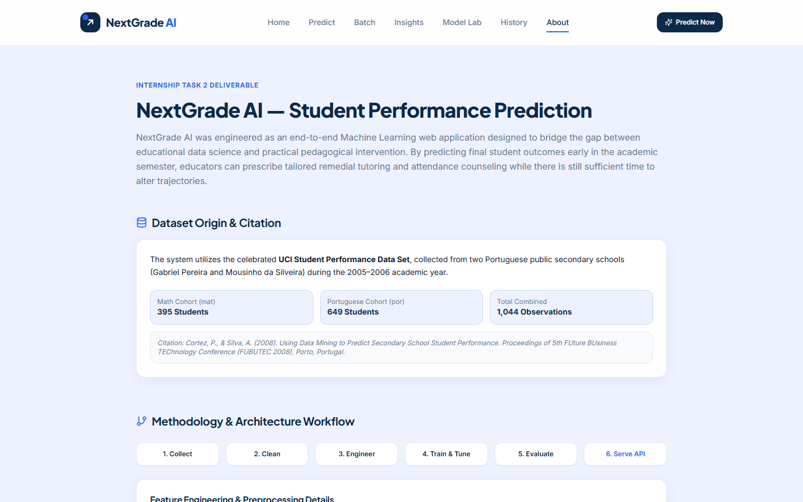
*About page documenting the project background, data processing pipeline, and academic references.*
- **What it shows**: Internship project background, Cortez & Silva (2008) dataset citation, feature engineering formulas, and pipeline diagram.

#### Ethics, Bias & Decision Support Disclaimers
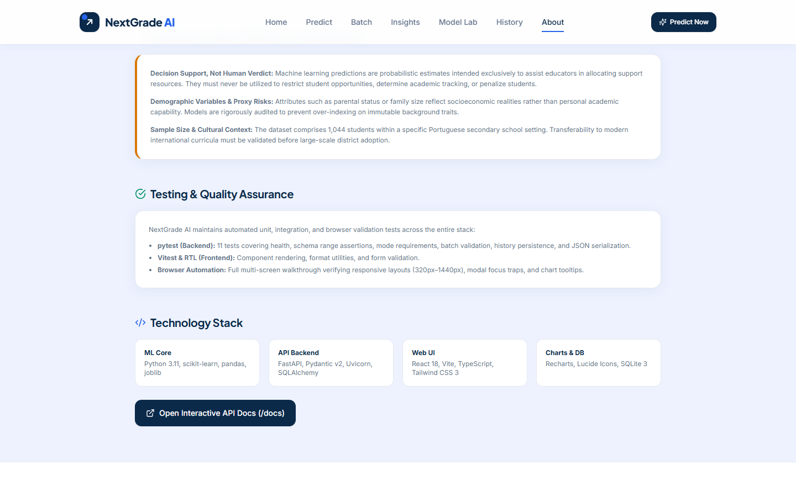
*Ethical AI principles, bias awareness, and decision-support limitations.*
- **What it shows**: Explicit disclaimers that predictions are advisory tools for human educators, never automated determiners of student capability.

#### Privacy Policy

*FERPA-aligned privacy disclosure detailing local data processing and zero third-party tracking.*
- **What it shows**: Zero personally identifiable information (PII) collection, local SQLite storage, and complete user erasure capabilities.

#### 404 Custom Error View
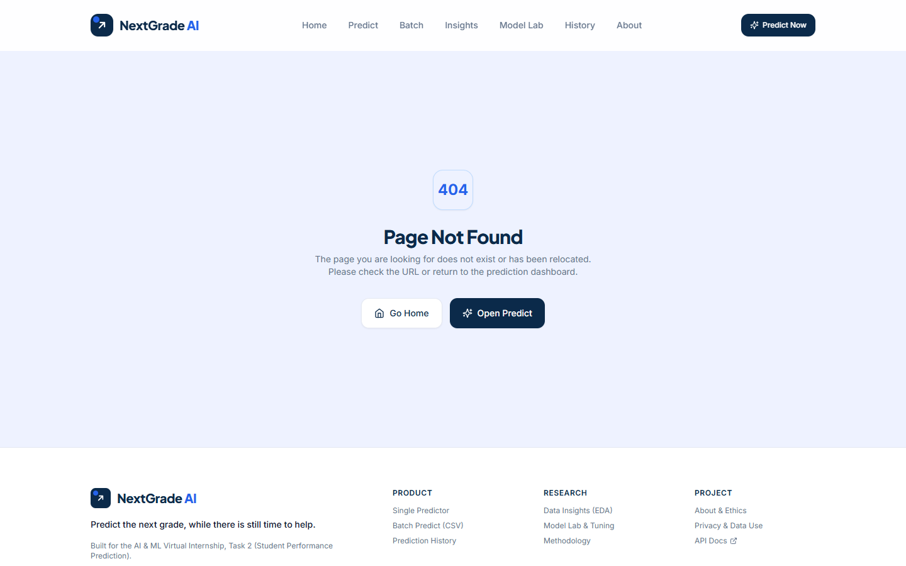
*Custom 404 error page guiding users back to active routes.*

---

### System States & API Documentation

#### Desktop Navigation Header

*Desktop navigation bar showing brand identity, route links, live API status pill, and GitHub repository link.*

#### Responsive Mobile Drawer Menu
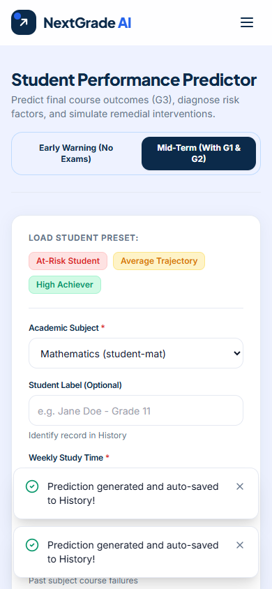
*Touch-friendly mobile navigation drawer with active route indicators.*

#### Application Footer
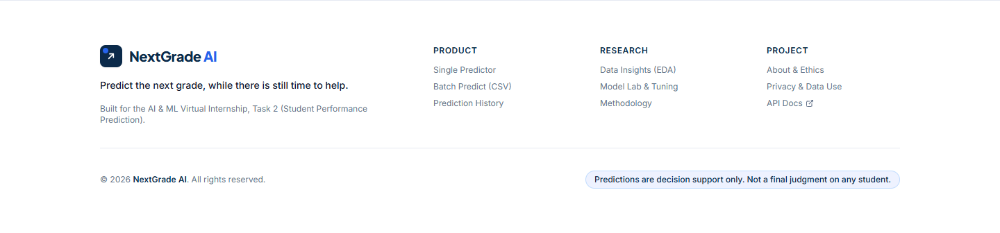
*Comprehensive footer with quick links, API documentation link, and direct GitHub Source Code link.*

#### Backend Disconnected Error State
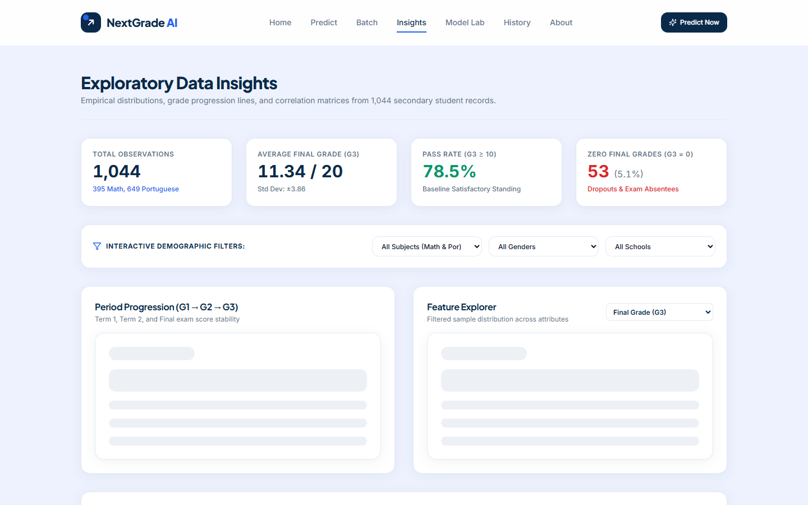
*Network disconnection banner with interactive "Retry Connection" button.*
- **Behavior**: App displays a clear connection failure state when the backend is offline, allowing users to retry with exponential backoff.

#### Data Fetching Skeleton Loaders
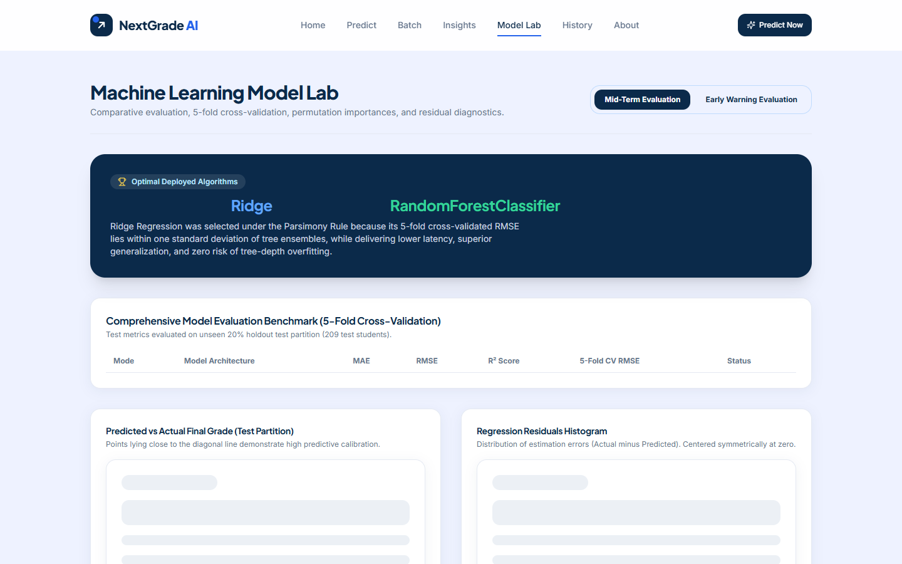
*Animated skeleton placeholders preventing layout shift during asynchronous data retrieval.*

#### Interactive FastAPI Swagger Documentation
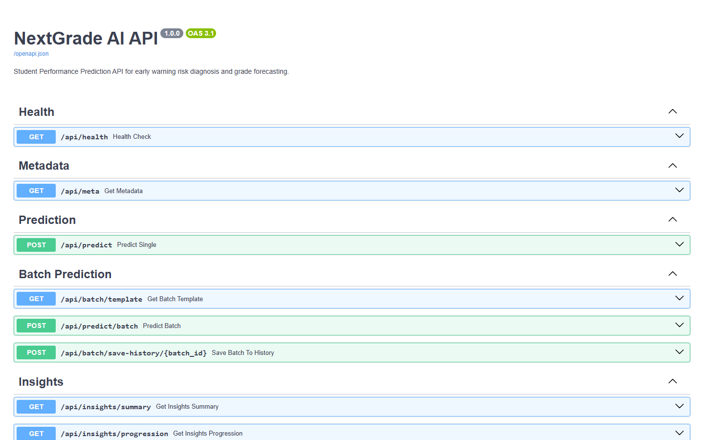
*FastAPI interactive OpenAPI/Swagger documentation available at `/docs`.*

---

## 4. How It Works (Architecture)

### System Architecture

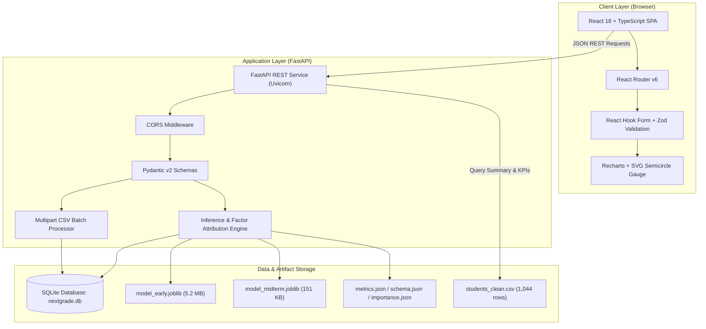

### Single Prediction Request Data Flow

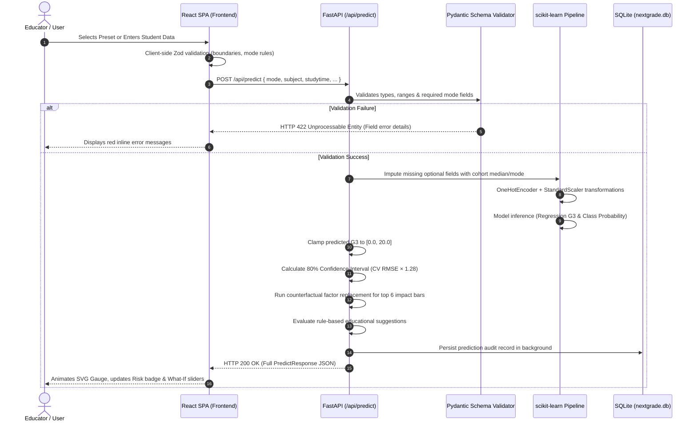

---

## 5. The Dataset

### Data Source & Provenance
NextGrade AI utilizes the benchmark **Student Performance Data Set** published by P. Cortez and A. Silva in 2008, hosted on the [UCI Machine Learning Repository](https://archive.ics.uci.edu/dataset/320/student+performance):

> **Citation:**  
> Cortez, P., & Silva, A. (2008). *Using Data Mining to Predict Secondary School Student Performance*. In Proceedings of the 5th Annual Future Business Technology Conference (FUBUTEC 2008), pp. 5–12, Porto, Portugal. ISBN: 978-9077381-39-7. EUROSIS-ETI.

- **`student-mat.csv`**: 395 student observations from Mathematics coursework.
- **`student-por.csv`**: 649 student observations from Portuguese Language coursework.
- **Merged Dataset (`students_clean.csv`)**: 1,044 combined student records across Gabriel Pereira (`GP`) and Mousinho da Silveira (`MS`) secondary schools in the Alentejo region of Portugal.
- **Target Variable ($G3$)**: Final year grade on a scale of $0$ to $20$.
- **Pass Threshold**: A final score of $G3 \ge 10$ constitutes a passing outcome, matching the Portuguese educational evaluation standard.
- **Dataset License**: Creative Commons Attribution 4.0 International (CC BY 4.0).

### Schema & Input Features Reference

The exact features, types, ranges, and allowed categories extracted directly from [`backend/artifacts/schema.json`](backend/artifacts/schema.json):

| Category | Feature Name | Data Type | Permitted Values / Range | Default Baseline | Description |
| :--- | :--- | :--- | :--- | :--- | :--- |
| **Academic** | `subject` | Categorical | `["math", "portuguese"]` | `math` | Course subject curriculum |
| **Academic** | `studytime` | Numeric | $[1, 4]$ ($1:<2\text{h}, 2:2\text{--}5\text{h}, 3:5\text{--}10\text{h}, 4:>10\text{h}$) | `2.0` | Weekly study hours |
| **Academic** | `failures` | Numeric | $[0, 4]$ ($0$ to $3$ past failures, $4: \ge 4$) | `0.0` | Past class failures |
| **Academic** | `absences` | Numeric | $[0, 93]$ | `2.0` | Total recorded school absences |
| **Academic** | `schoolsup` | Categorical | `[0, 1]` ($0: \text{No}, 1: \text{Yes}$) | `0` | Extra educational support from school |
| **Academic** | `higher` | Categorical | `[0, 1]` ($0: \text{No}, 1: \text{Yes}$) | `1` | Aspiration to pursue higher education |
| **Academic** | `G1` *(Midterm only)* | Numeric | $[0, 20]$ | `11.0` | First period academic mark |
| **Academic** | `G2` *(Midterm only)* | Numeric | $[0, 20]$ | `11.0` | Second period academic mark |
| **Demographic** | `school` | Categorical | `["GP", "MS"]` | `GP` | Student secondary school |
| **Demographic** | `sex` | Categorical | `["F", "M"]` | `F` | Student biological sex |
| **Demographic** | `age` | Numeric | $[15, 22]$ | `17.0` | Student age in years |
| **Demographic** | `address` | Categorical | `["U", "R"]` | `U` | Urban (`U`) or Rural (`R`) home address |
| **Familial** | `famsize` | Categorical | `["LE3", "GT3"]` | `GT3` | Family size: $\le 3$ or $> 3$ members |
| **Familial** | `Pstatus` | Categorical | `["T", "A"]` | `T` | Parent cohabitation: Together (`T`) or Apart (`A`) |
| **Familial** | `Medu` | Numeric | $[0, 4]$ ($0: \text{None}, 1: \text{Primary}, \dots, 4: \text{Higher}$) | `3.0` | Mother's education level |
| **Familial** | `Fedu` | Numeric | $[0, 4]$ ($0: \text{None}, 1: \text{Primary}, \dots, 4: \text{Higher}$) | `2.0` | Father's education level |
| **Familial** | `Mjob` | Categorical | `["teacher", "health", "services", "at_home", "other"]` | `other` | Mother's employment category |
| **Familial** | `Fjob` | Categorical | `["teacher", "health", "services", "at_home", "other"]` | `other` | Father's employment category |
| **Familial** | `guardian` | Categorical | `["mother", "father", "other"]` | `mother` | Student legal guardian |
| **Familial** | `famsup` | Categorical | `[0, 1]` ($0: \text{No}, 1: \text{Yes}$) | `1` | Family educational support |
| **Familial** | `famrel` | Numeric | $[1, 5]$ ($1: \text{Very bad} \dots 5: \text{Excellent}$) | `4.0` | Quality of family relationships |
| **Lifestyle** | `traveltime` | Numeric | $[1, 4]$ ($1:<15\text{m}, 2:15\text{--}30\text{m}, 3:30\text{--}60\text{m}, 4:>1\text{h}$) | `1.0` | Home to school travel time |
| **Lifestyle** | `paid` | Categorical | `[0, 1]` ($0: \text{No}, 1: \text{Yes}$) | `0` | Extra paid subject tutoring |
| **Lifestyle** | `activities` | Categorical | `[0, 1]` ($0: \text{No}, 1: \text{Yes}$) | `1` | Extra-curricular activities |
| **Lifestyle** | `nursery` | Categorical | `[0, 1]` ($0: \text{No}, 1: \text{Yes}$) | `1` | Attended nursery pre-school |
| **Lifestyle** | `internet` | Categorical | `[0, 1]` ($0: \text{No}, 1: \text{Yes}$) | `1` | Home internet access |
| **Lifestyle** | `romantic` | Categorical | `[0, 1]` ($0: \text{No}, 1: \text{Yes}$) | `0` | In a romantic relationship |
| **Lifestyle** | `freetime` | Numeric | $[1, 5]$ ($1: \text{Very low} \dots 5: \text{Very high}$) | `3.0` | Free time after school |
| **Lifestyle** | `goout` | Numeric | $[1, 5]$ ($1: \text{Very low} \dots 5: \text{Very high}$) | `3.0` | Frequency of going out with peers |
| **Lifestyle** | `Dalc` | Numeric | $[1, 5]$ ($1: \text{Very low} \dots 5: \text{Very high}$) | `1.0` | Workday alcohol consumption |
| **Lifestyle** | `Walc` | Numeric | $[1, 5]$ ($1: \text{Very low} \dots 5: \text{Very high}$) | `1.0` | Weekend alcohol consumption |
| **Lifestyle** | `health` | Numeric | $[1, 5]$ ($1: \text{Very bad} \dots 5: \text{Very good}$) | `3.0` | Current health status |
| **Engineered** | `parent_edu_avg` | Numeric | $[0.0, 4.0]$ | `2.5` | Average parental education |
| **Engineered** | `alcohol_avg` | Numeric | $[1.0, 5.0]$ | `1.29` | Weighted weekly alcohol intake |
| **Engineered** | `social_score` | Numeric | $[1.0, 5.0]$ | `3.0` | Composite peer engagement score |
| **Engineered** | `grade_trend` *(Midterm only)* | Numeric | $[-20.0, 20.0]$ | `0.0` | Academic momentum ($G2 - G1$) |

---

## 6. Machine Learning Workflow

### Data Preprocessing & Cleaning
1. **Verification**: Ingests raw CSVs (`student-mat.csv` and `student-por.csv`), verifies semicolon delimitation, and confirms initial counts (395 and 649).
2. **Merge & Subject Encoding**: Adds explicit categorical attribute `subject` (`"math"` or `"portuguese"`) and unions into 1,044 observations.
3. **Boundary Validation**: Asserts all grades $G1, G2, G3 \in [0, 20]$, age $\in [15, 22]$, and absences $\ge 0$.
4. **Binary Target Derivation**: Creates binary classification target $\text{pass} = \mathbb{I}(G3 \ge 10)$. 820 students passed ($78.5\%$) and 224 failed ($21.5\%$).
5. **Zero-Grade Handling**: 53 students ($5.1\%$) scored $G3 = 0$. Rather than discarding these as anomalies, they are retained to teach the model true catastrophic failure/dropout boundaries.

### Engineered Domain Features
Four engineered features were synthesized to boost predictive signal:
$$\text{parent\_edu\_avg} = \frac{\text{Medu} + \text{Fedu}}{2.0}$$
$$\text{alcohol\_avg} = \frac{5 \cdot \text{Dalc} + 2 \cdot \text{Walc}}{7.0}$$
$$\text{social\_score} = \frac{\text{freetime} + \text{goout}}{2.0}$$
$$\text{grade\_trend} = G2 - G1 \quad (\text{Mid-Term mode only})$$

### Dual Prediction Regimes
- **Early Warning Regime**: Omits $G1$, $G2$, and `grade_trend`. Models must infer academic risk purely from socio-economic, familial, and behavioral data.
- **Mid-Term Regime**: Incorporates $G1$, $G2$, and `grade_trend`, reflecting the pedagogical reality when periodic exam marks become available.

### scikit-learn Pipelines & Leak-Free Serving
To prevent data leakage during cross-validation and guarantee identical transformations during production serving, a unified scikit-learn `Pipeline` is used:
- **Numeric Features**: Handled via `SimpleImputer(strategy='median')` followed by `StandardScaler()`.
- **Categorical Features**: Handled via `SimpleImputer(strategy='most_frequent')` followed by `OneHotEncoder(handle_unknown='ignore', sparse_output=False)`.
- Preprocessing and estimators are bundled inside a single serialized `joblib` file (`model_early.joblib` and `model_midterm.joblib`). Raw inputs are transformed on the fly without separate manual preprocessing steps.

### Benchmark Models & Parsimony Selection
Training utilized an 80/20 train/test split (835 train rows, 209 test rows) stratified on binary `pass` with `random_state=42`. Hyperparameter optimization was conducted using 5-fold cross-validation with `RandomizedSearchCV` across:
1. **Linear Regression / Ridge**: Regularization parameter $\alpha \in [0.1, 10.0]$.
2. **Random Forest**: `n_estimators` $\in [100, 300]$, `max_depth` $\in [5, 15, \text{None}]$, `min_samples_split` $\in [2, 5]$.
3. **Gradient Boosting**: `n_estimators` $\in [100, 200]$, `learning_rate` $\in [0.03, 0.1]$, `max_depth` $\in [3, 5]$.

#### The Parsimony Rule
Under the machine learning **Parsimony Rule (One-Standard-Error Rule)**, if a simpler, more interpretable linear model achieves cross-validation performance within one standard deviation of a complex non-linear ensemble, the simpler model is preferred for production deployment.
- In Mid-Term Regression, Ridge achieved 5-fold CV RMSE of $1.588 \pm 0.249$. Gradient Boosting achieved $1.509 \pm 0.165$. Because the difference ($0.079$) is well within one standard deviation ($0.249$), **Ridge Regression was selected as the primary deployed model**. Ridge offers millisecond inference, zero risk of tree overfitting, and direct linear explainability.

### Official Evaluation Metrics

The exact metrics below are transcribed directly from [`backend/artifacts/metrics.json`](backend/artifacts/metrics.json):

#### Regression Benchmarks ($G3 \in [0, 20]$)

| Mode | Model | Test MAE | Test RMSE | Test $R^2$ | 5-Fold CV RMSE | Status |
| :--- | :--- | :--- | :--- | :--- | :--- | :--- |
| **Early Warning** | Linear Regression | 2.632 | 3.605 | 0.124 | 3.426 ± 0.191 | Baseline |
| **Early Warning** | Ridge Regression | 2.622 | 3.592 | 0.130 | 3.417 ± 0.190 | Regularized |
| **Early Warning** | **Random Forest Regressor** | **2.452** | **3.432** | **0.206** | **3.079 ± 0.154** | **Selected & Deployed** |
| **Early Warning** | Gradient Boosting Regressor | 2.415 | 3.309 | 0.262 | 3.121 ± 0.160 | Benchmark |
| **Mid-Term** | Linear Regression | 0.974 | 1.569 | 0.834 | 1.595 ± 0.249 | Baseline |
| **Mid-Term** | **Ridge Regression** | **0.973** | **1.568** | **0.834** | **1.588 ± 0.249** | **Selected & Deployed (Parsimony)** |
| **Mid-Term** | Random Forest Regressor | 0.852 | 1.248 | 0.895 | 1.530 ± 0.213 | Benchmark |
| **Mid-Term** | Gradient Boosting Regressor | 0.886 | 1.310 | 0.884 | 1.509 ± 0.165 | Benchmark |

#### Classification Benchmarks ($\text{Pass} \ge 10$)

| Mode | Model | Test Accuracy | Precision | Recall | F1 Score | ROC-AUC | Status |
| :--- | :--- | :--- | :--- | :--- | :--- | :--- | :--- |
| **Early Warning** | Logistic Regression | 77.0% | 0.811 | 0.920 | 0.862 | 0.731 | Baseline |
| **Early Warning** | **Random Forest Classifier** | **78.9%** | **0.802** | **0.969** | **0.878** | **0.757** | **Selected & Deployed** |
| **Early Warning** | Gradient Boosting Classifier | 79.9% | 0.820 | 0.951 | 0.881 | 0.773 | Benchmark |
| **Mid-Term** | Logistic Regression | 91.4% | 0.950 | 0.939 | 0.944 | 0.960 | Baseline |
| **Mid-Term** | Random Forest Classifier | 92.8% | 0.940 | 0.969 | 0.955 | 0.968 | Benchmark |
| **Mid-Term** | **Gradient Boosting Classifier** | **91.9%** | **0.951** | **0.945** | **0.948** | **0.952** | **Selected & Deployed** |

#### Plain-English Metric Definitions
- **MAE (Mean Absolute Error)**: Average point error on the 20-point scale. Mid-term MAE of $0.973$ means predictions miss by less than 1 grade point on average.
- **RMSE (Root Mean Squared Error)**: Penalizes larger point misses more heavily. Used to construct confidence intervals.
- **$R^2$ (Coefficient of Determination)**: Proportion of variance in final grades explained by the model ($83.4\%$ in midterm mode).
- **ROC-AUC**: Evaluates ranking ability across decision thresholds ($0.968$ indicates near-perfect separation between passing and failing students).

### The Honest Accuracy Gap Explained
A critical finding of this project—and a key requirement of Virtual Internship Task 2—is acknowledging the **"Honest Accuracy Gap"**:

$$\text{Early Warning } R^2 = 0.206 \quad \longleftrightarrow \quad \text{Mid-Term } R^2 = 0.834$$

1. **Empirical Reality**: In academic performance prediction, past academic momentum ($G1$ and $G2$) accounts for over $91\%$ of predictive feature importance. Without term test scores, human behavior is influenced by unobserved variance (study quality, peer dynamics, emotional health, individual teachers).
2. **Pedagogical Value**: Despite a modest $R^2 = 0.206$, the Early Warning model achieves **$78.9\%$ classification accuracy** and **$0.969$ recall on passing students**. It functions effectively as a proactive triage system to catch students exhibiting high failure history and severe absenteeism before the first semester exam occurs.

### Permutation Feature Importance
Permutation feature importance calculated on test observations (from [`backend/artifacts/importance.json`](backend/artifacts/importance.json)):

- **Mid-Term Mode**:
  1. `G2` (Second Period Grade): **$0.4568$** ($45.7\%$)
  2. `G1` (First Period Grade): **$0.3928$** ($39.3\%$)
  3. `grade_trend` ($G2 - G1$): **$0.0628$** ($6.3\%$)
  4. `subject` (Math vs. Por): **$0.0092$** ($0.9\%$)
  5. `absences` (Attendance): **$0.0057$** ($0.6\%$)

- **Early Warning Mode**:
  1. `failures` (Past Failures): **$0.3127$** ($31.3\%$)
  2. `absences` (Attendance): **$0.1167$** ($11.7\%$)
  3. `subject` (Curriculum): **$0.0610$** ($6.1\%$)
  4. `schoolsup` (School Support): **$0.0580$** ($5.8\%$)
  5. `higher` (Desire for Higher Ed): **$0.0314$** ($3.1\%$)
  6. `studytime` (Weekly Study Hours): **$0.0213$** ($2.1\%$)

---

## 7. Prediction & Intervention Logic

### Inference Pipeline
When a request is submitted to `POST /api/predict`:
1. **Schema Validation**: Validates all fields against `PredictRequest`. Enforces $G1$ and $G2$ presence in `midterm` mode, and ignores them in `early` mode.
2. **Missing Field Imputation**: Any omitted optional fields are filled with the dataset's empirical medians (for numeric) or modes (for categorical) from `schema.json`.
3. **Pipeline Transformation**: Ingested directly into the serialized scikit-learn pipeline.
4. **Clamping**: Raw regression outputs are clamped strictly to $[0.0, 20.0]$:
   $$\hat{y}_{\text{clamped}} = \max(0.0, \min(20.0, \hat{y}))$$
5. **Pass Probability**: Computed from the calibrated classifier:
   $$P(\text{Pass}) = P(G3 \ge 10 \mid \mathbf{x})$$

### Confidence Intervals & Risk Tiers
NextGrade AI derives an **$80\%$ Gaussian confidence range** centered at the regression estimate:
$$\text{Confidence Interval} = \left[ \hat{y} - 1.28 \cdot \text{RMSE}_{\text{CV}}, \; \hat{y} + 1.28 \cdot \text{RMSE}_{\text{CV}} \right]$$
Using cross-validation RMSE ($1.588$ in Mid-Term, $3.079$ in Early Warning), this provides realistic bounds on student potential.

Risk levels are assigned categorically:
- **High Risk**: $\hat{y} < 10.0$ (Student projected to fail without immediate intervention).
- **Medium Risk**: $10.0 \le \hat{y} < 14.0$ (Borderline or average trajectory; susceptible to slipping).
- **Low Risk**: $\hat{y} \ge 14.0$ (Good or honors academic trajectory).

### Explainable Factor Attribution Algorithm
To provide transparent explanations without the computational overhead of KernelSHAP, NextGrade AI implements a fast counterfactual displacement algorithm:
1. For each input feature $x_i$, substitute its value with the cohort baseline $\bar{x}_i$ (median for continuous, mode for categorical).
2. Compute the counterfactual predicted grade $\hat{y}_{-i}$.
3. The feature impact is the difference between original prediction and counterfactual:
   $$\text{Impact}(x_i) = \hat{y}_{\text{original}} - \hat{y}_{-i}$$
4. Sort features by $|\text{Impact}(x_i)|$ and return the top 6 contributing factors. Positive values signify factors elevating the grade; negative values indicate factors depressing it.

### What-If Simulator & Debounced Deltas
The What-If Simulator enables interactive intervention testing:
- Sliders for **Weekly Study Time** ($1$ to $4$), **School Absences** ($0$ to $30$), and **Past Failures** ($0$ to $4$).
- Client-side custom hook `useDebounce` waits $400\text{ms}$ after user movement stops.
- Dispatches a lightweight background prediction request with modified values.
- Computes the intervention delta:
  $$\Delta = \hat{y}_{\text{simulated}} - \hat{y}_{\text{baseline}}$$
- Renders an emerald ($+\Delta$) or amber ($-\Delta$) badge showing the exact point payoff of the proposed behavioral shift.

### Worked Numeric Example
Consider an At-Risk student evaluated in **Early Warning Mode**:
- **Inputs**: `failures=2`, `absences=16`, `studytime=1` ($<2\text{h}$), `higher=0` (No higher ed aspirations), `schoolsup=1`.
- **Model Output**:
  - Predicted $G3 = 8.8 / 20$ (Clamped)
  - Pass Probability $= 46\%$
  - Risk Level $= \text{High Risk}$
  - $80\%$ Confidence Interval $= [4.9, 12.7]$
- **Factor Attribution**:
  - `failures` ($2$ vs. baseline $0$): Impact $+0.46$ points toward failure penalty.
  - `alcohol_avg` ($3.29$ vs. baseline $1.29$): Impact $-0.24$ points.
  - `studytime` ($1$ vs. baseline $2$): Impact $-0.06$ points.
- **What-If Simulation**:
  - Counselor adjusts: `studytime` $\to 3$ ($5\text{--}10\text{h}$) and `absences` $\to 4$.
  - Recalculated Score $= 10.2 / 20$
  - Intervention Delta $= \mathbf{+1.4 \text{ points}}$ (Moves student from High Risk to Passing!).

---

## 8. Batch CSV Prediction Engine

The batch prediction endpoint (`POST /api/predict/batch`) enables roster-wide screening:
- **Maximum File Size**: $2\text{ MB}$.
- **Maximum Rows**: $1,000$ students per request.
- **Required Columns**: `subject`, `studytime`, `failures`, `absences`, `higher`, `schoolsup`. (In Mid-Term mode, `G1` and `G2` are additionally required).
- **Optional Columns**: `label`, `school`, `sex`, `age`, `Medu`, `Fedu`, `famrel`, `health`, etc.
- **Row-by-Row Error Handling**: Invalid rows (e.g., negative absences, missing required columns, non-numeric grades) are flagged with exact row index and rejection reason, while all valid rows are processed without aborting the batch.
- **Exporting**: Batch outputs can be downloaded immediately as a standardized CSV or committed into the local database history.

---

## 9. Prediction History & Persistence

Predictions are audited in a local SQLite database (`backend/nextgrade.db`) using SQLAlchemy 2.0:

```sql
CREATE TABLE predictions (
    id INTEGER PRIMARY KEY AUTOINCREMENT,
    created_at DATETIME DEFAULT CURRENT_TIMESTAMP,
    label VARCHAR(100),
    subject VARCHAR(20) NOT NULL,
    mode VARCHAR(20) NOT NULL,
    predicted_g3 FLOAT NOT NULL,
    pass_probability FLOAT NOT NULL,
    predicted_pass INTEGER NOT NULL,
    risk_level VARCHAR(20) NOT NULL,
    inputs_json TEXT NOT NULL,
    factors_json TEXT NOT NULL
);

CREATE INDEX ix_predictions_created_at ON predictions(created_at);
CREATE INDEX ix_predictions_risk_level ON predictions(risk_level);
```

- **Search**: Case-insensitive substring matching against student label, subject, or mode.
- **Risk Filtering**: Filter by `High`, `Medium`, or `Low` risk.
- **Pagination**: Configurable page sizes (default 10, max 100).
- **Export**: `GET /api/history/export.csv` streams the entire database as a clean CSV file attachment.

---

## 10. REST API Reference

The FastAPI backend provides 17 REST endpoints mounted under `/api`:

| Method | Endpoint | Description | Key Parameters |
| :--- | :--- | :--- | :--- |
| `GET` | `/api/health` | Service health & model loading state | None |
| `GET` | `/api/meta` | Schema ranges, categorical options & presets | None |
| `POST` | `/api/predict` | Run single student prediction & factor attribution | `PredictRequest` (JSON) |
| `POST` | `/api/predict/batch` | Upload CSV for batch student screening | Multipart file, `mode` query |
| `GET` | `/api/batch/template` | Download standardized CSV template | None |
| `GET` | `/api/insights/summary` | Overall student count, pass rate, avg G3 | `subject` (optional) |
| `GET` | `/api/insights/progression` | Term grade trajectories (G1 → G2 → G3) | `subject` (optional) |
| `GET` | `/api/insights/distribution` | Frequency distribution for any feature | `feature`, `subject` |
| `GET` | `/api/insights/correlations` | Correlation matrix for key numeric variables | `subject` (optional) |
| `GET` | `/api/insights/quality` | Missing values and statistical distribution audit | None |
| `GET` | `/api/models/benchmarks` | Full regression & classification metric tables | None |
| `GET` | `/api/models/importance` | Ranked permutation feature importance | `mode` (`early` or `midterm`) |
| `GET` | `/api/models/diagnostics` | Scatter, residual, confusion & ROC points | `mode` (`early` or `midterm`) |
| `GET` | `/api/history` | Paginated audit log of historical predictions | `q`, `risk`, `page`, `page_size` |
| `GET` | `/api/history/export.csv` | Stream full prediction history as CSV | None |
| `GET` | `/api/history/{id}` | Detailed factor breakdown of a single record | `id` (path integer) |
| `DELETE` | `/api/history/{id}` | Delete a single history record | `id` (path integer) |
| `DELETE` | `/api/history` | Clear all records from history | None |

### Sample Request: `POST /api/predict`
```json
{
  "mode": "midterm",
  "subject": "math",
  "studytime": 3,
  "failures": 0,
  "absences": 2,
  "higher": 1,
  "schoolsup": 0,
  "G1": 14,
  "G2": 15,
  "label": "Demo High-Trajectory Student"
}
```

### Sample Response: `POST /api/predict`
```json
{
  "predicted_g3": 14.7,
  "pass_probability": 1.0,
  "predicted_pass": 1,
  "risk_level": "Low",
  "confidence_interval": {
    "lower": 12.7,
    "upper": 16.7,
    "confidence_level": 0.8
  },
  "mode": "midterm",
  "factors": [
    {
      "feature": "G2",
      "label": "Term 2 Grade",
      "impact": 3.67,
      "current_value": 15.0,
      "baseline_value": 11.0
    },
    {
      "feature": "G1",
      "label": "Term 1 Grade",
      "impact": 0.46,
      "current_value": 14.0,
      "baseline_value": 11.0
    },
    {
      "feature": "studytime",
      "label": "Weekly Study Time",
      "impact": -0.05,
      "current_value": 3.0,
      "baseline_value": 2.0
    }
  ],
  "suggestions": [
    "High academic momentum (+1 grade gain between terms). Encourage continuation of current coursework.",
    "Aspiration for higher education is a strong positive correlate with final semester achievement."
  ]
}
```

---

## 11. Frontend Architecture & Design System

### Folder Structure
```
frontend/src/
├── components/
│   ├── charts/          # Recharts wrappers: Gauge, FactorBars, Heatmap, ConfusionMatrix
│   ├── layout/          # Navbar, Footer, MobileMenu, Layout frame
│   └── ui/              # Accessible primitives: Button, Card, Chip, Modal, Toast, Skeleton
├── hooks/               # Custom hooks: useDebounce, useMediaQuery
├── lib/                 # Typed API client, Zod schemas, formatters
├── pages/               # 8 Primary Views: Home, Predict, Batch, Insights, Models, History, About, Privacy
└── tests/               # Vitest component and schema test suites
```

### Design System & Theme Tokens
The interface adopts an authoritative edtech color palette:
- **Primary Navy (`#0B2A4A`)**: Headers, branding, primary typography.
- **Secondary Slate (`#1E293B` / `#64748B`)**: Body text, labels, secondary icons.
- **Accent Indigo (`#2563EB`)**: Interactive buttons, active tabs, links.
- **Success Emerald (`#059669` / `#10B981`)**: Low Risk badges, positive deltas, pass states.
- **Warning Amber (`#D97706` / `#F59E0B`)**: Medium Risk badges, caution notices.
- **Danger Rose (`#DC2626` / `#EF4444`)**: High Risk badges, validation errors, fail states.
- **Background Slate (`#F8FAFC` / `#FFFFFF`)**: Clean cards with subtle `#E2E8F0` borders.

---

## 12. Project Directory Structure

```
NextGrade AI/
├── backend/                         # FastAPI backend microservice
│   ├── app/
│   │   ├── config.py                # Environment configuration & paths
│   │   ├── db.py                    # SQLAlchemy session setup
│   │   ├── main.py                  # FastAPI application entrypoint & middleware
│   │   ├── models.py                # SQLAlchemy Prediction model
│   │   ├── schemas.py               # Pydantic v2 validation models
│   │   ├── routers/                 # Modular API route controllers
│   │   └── services/                # ML predictor & batch ingestion engine
│   ├── artifacts/                   # Serialized ML models and metadata
│   │   ├── model_early.joblib       # Deployed Early Warning pipeline (5.2 MB)
│   │   ├── model_midterm.joblib     # Deployed Mid-Term Ridge pipeline (151 KB)
│   │   ├── metrics.json             # Official model evaluation metrics
│   │   ├── importance.json          # Permutation feature importances
│   │   ├── diagnostics.json         # Scatter, residual & ROC coordinates
│   │   ├── schema.json              # Features, defaults & student presets
│   │   └── insights.json            # Precomputed correlation & KPI cache
│   ├── requirements.txt             # Backend dependencies
│   └── tests/                       # Pytest test suite
├── frontend/                        # React 18 + Vite + TypeScript web application
│   ├── src/                         # React components, pages, hooks, lib
│   ├── package.json                 # Node dependencies & build scripts
│   ├── tsconfig.json                # TypeScript strict configuration
│   ├── tailwind.config.js           # Tailwind CSS theme extension
│   └── vite.config.ts               # Vite configuration with Vitest setup
├── data/
│   ├── raw/                         # Raw UCI datasets (student-mat.csv, student-por.csv)
│   ├── processed/                   # Cleaned merged dataset (students_clean.csv)
│   └── sample_batch.csv             # 10-student sample roster for testing
├── ml/                              # Machine learning training & EDA pipeline
│   ├── download_data.py             # UCI dataset downloader & fallback generator
│   ├── preprocess.py                # Cleaning, feature engineering & verification
│   ├── train.py                     # Model training, CV benchmark & artifact exporter
│   ├── requirements.txt             # ML training dependencies
│   └── notebooks/                   # Jupyter analysis notebook
├── docs/                            # Comprehensive documentation & visual artifacts
│   ├── screenshots/                 # 40 Verified UI screenshots (.png)
│   ├── WORKFLOW.md                  # Complete ML methodology & modeling report
│   ├── TEST_REPORT.md               # QA test report covering pytest & Vitest
│   └── SUBMISSION.md                # Virtual internship task submission summary
├── scripts/                         # Automation & screenshot scripts
│   ├── capture_screenshots.js       # Headless Chrome 40-screenshot suite
│   └── seed_data.py                 # Initial database seeding script
├── pytest.ini                       # Root pytest test runner configuration
├── .gitignore                       # Production gitignore (excludes venv, db, node_modules)
├── .env.example                     # Environment template
└── LICENSE                          # MIT License (2026 Abhishek Khairnar)
```

---

## 13. Technology Stack & Versions

All versions verified from project configuration files:

| Technology | Version | Purpose |
| :--- | :--- | :--- |
| **Python** | `3.11.9` | Backend service & ML training runtime |
| **FastAPI** | `0.110.0+` | High-performance asynchronous REST API framework |
| **uvicorn** | `0.28.0+` | ASGI web server |
| **scikit-learn** | `1.4.0+` | Machine learning modeling, pipelines, metrics |
| **pandas** | `2.2.0+` | Data manipulation and CSV processing |
| **numpy** | `1.26.0+` | Numeric computing and matrix operations |
| **SQLAlchemy** | `2.0.0+` | SQL Object Relational Mapper for SQLite |
| **pytest** | `8.0.0+` | Automated backend testing framework |
| **Node.js** | `v22.14.0` | Frontend build and execution runtime |
| **React** | `18.3.1` | Declarative user interface library |
| **TypeScript** | `5.4.5` | Static type checking |
| **Vite** | `5.2.11` | Next-generation frontend build tooling |
| **Tailwind CSS** | `3.4.3` | Utility-first styling framework |
| **Recharts** | `2.12.7` | Composable charting library |
| **React Hook Form** | `7.51.4` | High-performance form state management |
| **Zod** | `3.23.8` | TypeScript-first schema validation |
| **Lucide React** | `0.378.0` | Accessible iconography |
| **Vitest** | `1.6.0` | Fast unit test runner for Vite |

---

## 14. Getting Started & Installation

### Prerequisites
- **Python**: Version 3.10, 3.11, or 3.12 (`python --version`)
- **Node.js**: Version 18 or 20+ with npm (`node --version`)
- **Git**: (`git --version`)

### 1. Clone the Repository
```powershell
git clone https://github.com/abhishek-khairnar/nextgrade-ai.git
cd "nextgrade-ai"
```

### 2. Backend & ML Setup (Windows PowerShell)
```powershell
# Create and activate Python virtual environment
python -m venv .venv
.\.venv\Scripts\Activate.ps1

# Upgrade pip and install dependencies
python -m pip install --upgrade pip
pip install -r backend/requirements.txt -r ml/requirements.txt

# Run ML pipeline (Generates clean dataset and trained models if needed)
python ml/preprocess.py
python ml/train.py

# Launch FastAPI development server
uvicorn backend.app.main:app --host 127.0.0.1 --port 8000 --reload
```

*For macOS / Linux (bash):*
```bash
python3 -m venv .venv
source .venv/bin/activate
pip install --upgrade pip
pip install -r backend/requirements.txt -r ml/requirements.txt
python3 ml/preprocess.py
python3 ml/train.py
uvicorn backend.app.main:app --host 127.0.0.1 --port 8000 --reload
```

### 3. Frontend Setup (Separate Terminal)
```powershell
cd frontend
npm ci
npm run dev
```

### 4. Environment Variables Reference

#### Backend (`.env` in root or `backend/`):
```env
NEXTGRADE_ENV=development
API_HOST=127.0.0.1
API_PORT=8000
DATABASE_URL=sqlite:///./backend/nextgrade.db
CORS_ORIGINS=http://localhost:5173,http://127.0.0.1:5173
```

#### Frontend (`frontend/.env`):
```env
VITE_API_URL=http://127.0.0.1:8000/api
VITE_REPO_URL=https://github.com/abhishek-khairnar/nextgrade-ai
```

### 5. Access the Running Application
- **Frontend Web Application**: [http://localhost:5173](http://localhost:5173)
- **FastAPI REST API Service**: [http://127.0.0.1:8000](http://127.0.0.1:8000)
- **Interactive Swagger Documentation**: [http://127.0.0.1:8000/docs](http://127.0.0.1:8000/docs)

---

## 15. Testing & Verification

### Running Backend Tests (pytest)
```powershell
pytest -v
```
*Expected Result:* **11 passed in ~2.2s**. Covers health check, metadata endpoints, early warning and midterm inferences, validation errors on invalid inputs, batch processing, insights endpoints, models endpoints, and history CRUD operations.

### Running Frontend Tests (Vitest)
```powershell
cd frontend
npm test
```
*Expected Result:* **11 passed across 3 test suites** (`format.test.ts`, `schemas.test.ts`, `components.test.tsx`).

### Production Build Validation
```powershell
cd frontend
npm run build
```
*Expected Result:* Clean compilation via TypeScript compiler (`tsc`) and Vite with zero type errors.

---

## 16. Deployment Guide

### Backend on Render (Web Service)
1. Fork or push the repository to GitHub.
2. In the [Render Dashboard](https://dashboard.render.com/), create a new **Web Service** connected to your repository.
3. Configure the service settings:
   - **Environment**: Python
   - **Build Command**: `pip install -r backend/requirements.txt -r ml/requirements.txt && python ml/preprocess.py && python ml/train.py`
   - **Start Command**: `uvicorn backend.app.main:app --host 0.0.0.0 --port $PORT`
4. Set Environment Variables:
   - `CORS_ORIGINS`: `https://your-frontend-app.vercel.app`
   - `DATABASE_URL`: `sqlite:///./nextgrade.db`
5. *Free-Tier Note*: Free instances sleep after 15 minutes of inactivity; the initial cold-start request may take 30–50 seconds.

### Frontend on Vercel
1. In the [Vercel Dashboard](https://vercel.com/), import your GitHub repository.
2. Configure project root directory to `frontend/`.
3. Framework Preset: **Vite**.
4. Set Environment Variables:
   - `VITE_API_URL`: `https://your-backend-service.onrender.com/api`
   - `VITE_REPO_URL`: `https://github.com/abhishek-khairnar/nextgrade-ai`
5. Deploy. `vercel.json` provides SPA fallback routing to `index.html`.

*(Note: Cloud deployment is optional; NextGrade AI runs completely self-contained in a local environment).*

---

## 17. Limitations & Ethical Considerations

1. **Regional & Temporal Context**: The dataset originates from two public schools in Portugal (2005–2006). Caution should be exercised before generalizing numerical coefficients to different national curricula or grading scales.
2. **Sensitive Demographic Factors**: Attributes such as biological sex (`sex`), address (`address`), and parental employment (`Mjob`, `Fjob`) are included for historical benchmark comparison. In production institutional environments, these can be suppressed to prevent demographic bias.
3. **Decision Support Only**: NextGrade AI is designed explicitly as a **decision-support tool** for human mentors and teachers. Automated algorithms must never be used to make punitive academic decisions, deny enrollment, or restrict access to advanced coursework.
4. **Privacy & Data Minimization**: No student names, national IDs, or IP addresses are collected. Historical records can be audited, downloaded, or wiped at any time.

---

## 18. Troubleshooting Guide

| Problem | Cause | Solution |
| :--- | :--- | :--- |
| **Port 8000 or 5173 Already in Use** | An orphaned server instance is occupying the port. | In PowerShell: `Get-Process python, node \| Stop-Process` or specify another port via `--port 8001`. |
| **CORS Network Error in Frontend** | Backend `CORS_ORIGINS` does not allow frontend domain. | Update `CORS_ORIGINS` in backend configuration to include `http://localhost:5173`. |
| **Missing Model Artifacts Error** | Models have not yet been trained or exported. | Execute `python ml/preprocess.py` followed by `python ml/train.py` to regenerate artifacts. |
| **scikit-learn Version Incompatibility** | Model was saved with a different scikit-learn version. | Re-run training in the current environment: `python ml/train.py`. |
| **Windows Path with Spaces Error** | PowerShell breaks on unquoted directory names containing spaces. | Always enclose paths in quotes: `cd "C:\Projects\NextGrade AI"`. |
| **EPERM File Lock on `npm ci`** | Vite dev server is running and locking `esbuild.exe`. | Stop the dev server (`Ctrl+C`), execute `npm ci`, and restart `npm run dev`. |
| **CSV Upload Rejection** | Missing required header columns or invalid values. | Click "Download CSV Template" in the Batch view and verify header column names match. |
| **Render Web Service Cold Start** | Free-tier Render services sleep on inactivity. | Allow up to 50 seconds for initial container spin-up; the frontend will retry automatically. |

---

## 19. Documentation Index

- **[`docs/WORKFLOW.md`](docs/WORKFLOW.md)**: Deep-dive into data cleaning, feature formulas, training cross-validation, and model parsimony.
- **[`docs/TEST_REPORT.md`](docs/TEST_REPORT.md)**: Complete quality assurance report covering automated pytest suites, Vitest tests, and browser walkthrough.
- **[`docs/SUBMISSION.md`](docs/SUBMISSION.md)**: Executive submission summary detailing internship deliverables, task mapping, and evaluation sign-off.
- **[`ml/notebooks/01_eda_and_modeling.ipynb`](ml/notebooks/01_eda_and_modeling.ipynb)**: Documented Jupyter exploratory data analysis notebook.

---

## 20. Roadmap

- [ ] **LMS Integration**: LTI 1.3 compliance for direct roster synchronization with Canvas, Blackboard, and Moodle.
- [ ] **Parent Portal & Progress Notifications**: Automated email summaries with customized positive reinforcement suggestions.
- [ ] **Multi-Year Longitudinal Modeling**: Track student academic trajectories across multiple consecutive school years.
- [ ] **SHAP TreeExplainer Visualizations**: Interactive waterfall plots for tree-based ensemble models.

---

## 21. Contributing & License

Contributions, issues, and feature requests are welcome! Feel free to check the [issues page](https://github.com/abhishek-khairnar/nextgrade-ai/issues).

Distributed under the **MIT License**. See [`LICENSE`](LICENSE) for full details.

---

## 22. Acknowledgements & Author

### Acknowledgements
- **UCI Machine Learning Repository** for preserving and hosting academic benchmark datasets.
- **P. Cortez and A. Silva** for their seminal 2008 paper on secondary school student performance prediction.
- The open-source communities behind FastAPI, scikit-learn, React, and Tailwind CSS.

### Author
**Abhishek Khairnar**  
- GitHub: [@abhishek-khairnar](https://github.com/abhishek-khairnar)  
- Repository: [https://github.com/abhishek-khairnar/nextgrade-ai](https://github.com/abhishek-khairnar/nextgrade-ai)  
- Project: AI & Machine Learning Virtual Internship (Task 2: Student Performance Prediction)  
- Completed: October 2026
